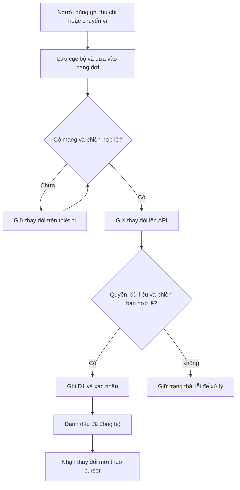

# Luồng nghiệp vụ — Ứng dụng Quản lý thu chi

> Phạm vi: dự án `qualythuchi/`. Các đường dẫn mã nguồn trong tài liệu tính từ thư mục gốc dự án này.
>
> Cập nhật: 04/11/2026. Tài liệu đọc nhanh để hiểu mục đích, người dùng, dữ liệu và cách các chức năng liên kết với nhau.
>
> Nội dung được đối chiếu với mã nguồn hiện tại và tài liệu yêu cầu. “Đã có mã nguồn” không đồng nghĩa đã nghiệm thu production hoặc đã kiểm thử đầy đủ trên iPhone thật. Kết quả chạy local, lint/typecheck/test/build và E2E mới nhất được ghi trong README và kế hoạch N00–N07.

## 1. Dự án giải quyết việc gì?

Ứng dụng giúp mỗi người ghi chép tiền vào/ra, biết tiền đang nằm ở ví nào, theo dõi ngân sách và mục tiêu tiết kiệm, đồng thời nhận nhắc các khoản thanh toán. Giao diện tiếng Việt, hướng tới PWA cài từ Safari lên màn hình chính iPhone; phát triển và chạy local trên Windows được.

Hệ thống dự kiến phục vụ nhóm nhỏ khoảng 2–3 tài khoản. Mỗi tài khoản có sổ tài chính riêng. Super Admin quản trị tài khoản và được thao tác dữ liệu của người khác theo quyền được máy chủ kiểm tra.

Luồng sử dụng phổ biến:

1. Super Admin cấp tài khoản.
2. Người dùng đăng nhập, tạo ví và kiểm tra danh mục.
3. Hằng ngày ghi thu/chi hoặc chuyển tiền giữa các ví.
4. Xem dashboard, ngân sách và báo cáo để hiểu tình hình tài chính.
5. Theo dõi tiết kiệm, thiết lập các khoản định kỳ và xác nhận khi thanh toán.
6. Khi có mạng, ứng dụng gửi thay đổi đang chờ và nhận dữ liệu mới từ máy chủ.

Không có đăng ký công khai, đồng bộ ngân hàng tự động hoặc sổ thu chi dùng chung giữa các User trong phạm vi bản đầu.

## 2. Vai trò và quyền dữ liệu

| Tác vụ | USER | SUPER_ADMIN |
|---|---|---|
| Đăng nhập và quản lý tài chính cá nhân | Có | Có |
| Đọc/thêm/sửa/xóa dữ liệu tài khoản khác | Không | Có, theo API và màn hình đã triển khai |
| Tạo và quản trị tài khoản | Không | Có |
| Xem nhật ký quản trị | Không | Có |
| Tự đăng ký tài khoản | Không | Không |
| Backup/restore Google Drive | Chưa triển khai | Chưa triển khai |

Hai khái niệm phải phân biệt:

- **Người thao tác**: tài khoản đang đăng nhập, ví dụ Super Admin.
- **Chủ dữ liệu (`ownerUserId`)**: tài khoản sở hữu ví, giao dịch, ngân sách hoặc mục tiêu đang được thao tác.

Ví dụ: Admin thêm khoản chi cho User A thì khoản chi thuộc User A, tác động số dư của A và được ghi nhận trong nhật ký quản trị. Không cộng khoản chi đó vào sổ riêng của Admin.

Máy chủ xác minh phiên, vai trò và chủ dữ liệu; việc ẩn nút ở giao diện không phải cơ chế phân quyền duy nhất. Super Admin chỉ nhìn thấy dữ liệu đã tới máy chủ, không thể đọc thay đổi còn nằm trong hàng đợi offline trên thiết bị người khác.

## 3. Các đối tượng nghiệp vụ

| Đối tượng | Ý nghĩa | Liên hệ chính |
|---|---|---|
| Tài khoản | Danh tính, vai trò, trạng thái hoạt động | Sở hữu dữ liệu tài chính |
| Ví/tài khoản tiền | Nơi giữ tiền: tiền mặt, tài khoản ngân hàng… | Có số dư ban đầu, nhận thu/chi và chuyển ví |
| Danh mục | Phân loại khoản thu hoặc chi | Gắn với giao dịch và ngân sách danh mục |
| Giao dịch | Một khoản thu hoặc chi đã ghi sổ | Thuộc một ví, một danh mục và một chủ dữ liệu |
| Chuyển ví | Di chuyển tiền trong cùng sổ tài chính | Gồm ví nguồn và ví đích, tách khỏi thu/chi |
| Ngân sách | Giới hạn chi tiêu của một tháng | Toàn bộ chi hoặc một danh mục chi |
| Mục tiêu tiết kiệm | Số tiền muốn dành được và hạn nếu có | Có các khoản đóng góp để tính tiến độ |
| Khoản đóng góp | Số tiền ghi nhận đã dành cho mục tiêu | Hiện độc lập với giao dịch và số dư ví |
| Lịch định kỳ | Mẫu thu/chi lặp lại theo ngày/tuần/tháng | Chỉ tạo giao dịch sau khi xác nhận từng kỳ |
| Thông báo | Nhắc việc, cảnh báo và tiến độ | Có nội dung trong ứng dụng; push cần cấu hình |
| Hàng đợi đồng bộ | Những thay đổi chưa được máy chủ xác nhận | Hiện nhận ghi thu/chi và tạo chuyển ví |
| Nhật ký quản trị | Ai đã thay đổi dữ liệu của ai | Dùng để tra cứu hoạt động quản trị |

Tiền được lưu bằng **số nguyên VND**. Số tiền giao dịch phải lớn hơn 0; loại thu/chi quyết định chiều biến động. Hệ thống cho phép số dư âm trong giới hạn số nguyên an toàn.

## 4. Đăng nhập, phiên và đăng xuất

### 4.1. Đăng nhập bằng mật khẩu

1. Người dùng mở `/` hoặc `/login`, nhập username và mật khẩu.
2. Máy chủ kiểm tra tài khoản, trạng thái hoạt động và mật khẩu đã băm.
3. Nếu hợp lệ, máy chủ cấp phiên bằng cookie; ứng dụng nhận thông tin người dùng và token CSRF phục vụ các yêu cầu thay đổi dữ liệu.
4. Giao diện xác minh phiên trước khi cho truy cập các trang được bảo vệ.
5. Nếu không xác minh được do mất kết nối, hiển thị trạng thái cần thử lại; không tự coi đó là đăng nhập thành công.

Khi mở lần đầu và chưa có phiên, thiếu cookie là trạng thái chưa đăng nhập bình thường: chỉ hiển thị form, không cảnh báo lỗi cookie. Cảnh báo mất cookie khi kiểm tra lại phiên chỉ dành cho tài khoản đã được ghi nhớ trước đó; sau khi gửi đăng nhập thành công vẫn phải kiểm tra trình duyệt gửi lại cookie.

Đăng nhập mới cần mạng. Khả năng ghi offline sau khi đã vào ứng dụng không có nghĩa có thể mở lại ứng dụng và đăng nhập offline trong mọi tình huống.

### 4.2. Passkey

Người dùng đã đăng nhập có thể quản lý Passkey trong khu vực tài khoản. Khi đã đăng ký và thiết bị/origin hỗ trợ, có thể dùng Passkey để đăng nhập. Việc xác thực có thể dùng cơ chế của thiết bị; ứng dụng không bảo đảm luôn gọi Face ID cụ thể.

Đăng nhập Apple ID và quên mật khẩu tự phục vụ chưa phải luồng hoàn chỉnh đang có. Admin có thể đặt lại mật khẩu qua quản trị tài khoản.

### 4.3. Đăng xuất hoặc đổi tài khoản

Ứng dụng xử lý kết thúc phiên và dọn dữ liệu phiên/cache theo tài khoản. Các thay đổi chưa đồng bộ được giữ riêng theo chủ dữ liệu. Nếu không thể hoàn tất việc kết thúc phiên hoặc xử lý dữ liệu cục bộ, ứng dụng có thể chặn chuyển trạng thái và yêu cầu thử lại.

Không hiển thị dữ liệu tài khoản trước cho tài khoản đăng nhập sau. Đăng xuất không phải thao tác gửi hết hàng đợi lên máy chủ và cũng không phải sao lưu dữ liệu.

### 4.4. Kéo xuống để làm mới dữ liệu trên điện thoại

Ở đầu trang, kéo xuống bằng một ngón tay đến khi hiện **Thả để làm mới**, rồi thả để tự lấy dữ liệu mới của màn hình đang mở. Không reload tài liệu, không cần bấm **Cập nhật**, không đổi URL/bộ lọc và không xóa bản nháp. Vòng tròn tải hiển thị đè lên giao diện, giữ nội dung và vị trí cuộn. Offline/API lỗi giữ dữ liệu đang có và báo rõ để kéo thử lại. Nút Cập nhật PWA chỉ dành cho phiên bản mã ứng dụng mới, độc lập với làm mới dữ liệu.

Thao tác không kích hoạt khi trang đã cuộn xuống, vuốt ngang, đa chạm, trong vùng cuộn riêng, khi trường nhập đang được sửa hoặc hộp thoại đang mở. Cử chỉ được hủy khi đổi route. Cơ chế dùng chung ở RootLayout, có xử lý safe area và giảm chuyển động; kiểm chứng iPhone thật vẫn theo UAT riêng.

Màn hình có dữ liệu đăng ký loader bằng `usePageLoader`; scope gồm chủ dữ liệu và bộ lọc gửi lên server. Khi đổi scope/unmount phải hủy request và kiểm tra signal trước khi ghi state. GET trùng đang chạy dùng chung transport; hủy một bên không hủy bên còn đọc. Danh sách đầy đủ dùng `cacheRemoteList` để giữ bản sửa/xóa chưa gửi trong outbox; không đưa danh sách phân trang vào helper này. Không tự thêm polling dữ liệu màn hình. Sync outbox giữ retry 30 giây khi ứng dụng đang hiển thị và có mạng; dừng timer khi ở nền/offline.

## 5. Chuẩn bị ví và danh mục

### 5.1. Ví

**Giao diện người dùng hiện ẩn ví** (quyết định 04/11/2026: người dùng chỉ cần hạn mức chi theo tháng). Lần đầu mở Thu chi hoặc Định kỳ khi có mạng, frontend tự tạo ví mặc định `Ví chính` nếu tài khoản chưa có ví (`apps/frontend/src/features/finance/default-wallet.ts`). Giao dịch/lịch mới tự gán vào ví mặc định (ưu tiên tên `Ví chính`, nếu không có thì ví đầu tiên); sửa giao dịch giữ ví cũ. Form không còn ô chọn ví, danh sách giao dịch/lịch không hiện tên ví. Tab Ví được thay bằng tab Ngân sách; `/wallets`, `/transfers` vẫn giữ route, chỉ bỏ lối vào từ menu. Database, API, đồng bộ và công thức số dư không đổi; Admin tài chính vẫn quản lý ví như cũ. Lần đầu chưa có ví mà offline thì chưa ghi được giao dịch cho đến khi có mạng.

Luồng ví đầy đủ (khi mở trực tiếp `/wallets`):

1. Vào `/wallets`, tạo ví với tên, loại ví, số dư ban đầu và thông tin tài khoản nếu cần.
2. Máy chủ kiểm tra dữ liệu, tên trùng và quyền sở hữu.
3. Ví xuất hiện trong danh sách chọn khi nhập thu/chi, chuyển ví và lập lịch định kỳ.
4. Có thể sửa thông tin và số dư ban đầu; sửa số dư ban đầu sẽ ảnh hưởng số dư hiện tại.

Ví đã có giao dịch/chuyển ví tham chiếu bị chặn xóa để giữ liên kết lịch sử. Các tham chiếu khác còn phải tuân thủ ràng buộc cơ sở dữ liệu. Không nên mô tả thao tác xóa ví là xóa luôn toàn bộ lịch sử tài chính.

### 5.2. Danh mục

1. Vào `/categories`; hệ thống có danh mục mặc định theo tài khoản.
2. Người dùng thêm hoặc sửa danh mục loại **thu** hoặc **chi**.
3. Khi ghi giao dịch, danh mục phải đúng loại và cùng chủ dữ liệu với ví/giao dịch.

Hiện backend không cho xóa danh mục mặc định, và chặn xóa danh mục đã được giao dịch tham chiếu. Đây là chi tiết triển khai hiện tại dù yêu cầu ban đầu mô tả khả năng chỉnh sửa/xóa danh mục ở mức tổng quát.

## 6. Ghi, sửa, xóa và hoàn tác thu/chi

### 6.1. Ghi giao dịch

1. Vào `/transactions`, bấm **Thêm** để mở màn hình riêng `/transactions/new` (không còn popup; `?type=INCOME` chọn sẵn loại thu). Sửa giao dịch mở `/transactions/:transactionId`; liên kết cũ `/transactions?transactionId=` tự chuyển sang đường dẫn này. Lưu xong hoặc Hủy thì quay lại màn hình trước (mở trực tiếp thì về `/transactions`). Dữ liệu dùng chung qua `useTransactionData`; kéo làm mới không xóa nội dung đang nhập. Popup xác nhận xóa vẫn giữ dạng hộp thoại. Giao diện form: chọn Khoản chi/Khoản thu dạng pill, ô số tiền lớn theo màu loại, lưới icon danh mục (icon/màu suy từ tên danh mục ở `category-icons.ts`, chưa lưu icon trong database), chip Hôm nay/Hôm qua cho ngày, nút Hủy/Lưu cố định ở đáy và ẩn thanh tab trên màn hình này.
2. Chọn thu hoặc chi, nhập số tiền, ví, danh mục, ngày giờ; bổ sung ghi chú và nhãn nếu cần.
3. Ứng dụng kiểm tra đầu vào, lưu thay đổi cục bộ và đưa vào hàng đợi đồng bộ.
4. Giao diện phản ánh thay đổi cục bộ; khi có mạng và phiên hợp lệ, hàng đợi được gửi lên máy chủ.
5. Máy chủ kiểm tra lại quyền và các ràng buộc, ghi dữ liệu rồi phát thay đổi cho các thiết bị khác nhận.

Một giao dịch vừa xuất hiện trên thiết bị chưa nhất thiết đã tới máy chủ. Dashboard/báo cáo lấy từ máy chủ và dữ liệu cục bộ có thể tạm thời khác nhau khi còn thay đổi chờ đồng bộ.

### 6.2. Sửa giao dịch

Người dùng mở giao dịch, đổi thông tin và lưu. Số dư, tổng thu/chi và báo cáo phải phản ánh giá trị mới thay cho giá trị cũ. Khi đồng bộ, phiên bản bản ghi được kiểm tra để phát hiện trường hợp dữ liệu đã bị sửa trên thiết bị khác.

### 6.3. Xóa và hoàn tác

1. Bấm xóa ở màn hình Giao dịch mở popup xác nhận, hiển thị số tiền, ghi chú và ngày; mặc định focus **Hủy**. Hủy/Đóng/Escape không ghi outbox hoặc xóa dữ liệu. Chỉ nút xác nhận mới thực hiện; khóa nhấn trùng, không cho đóng popup khi đang lưu. Nếu lưu cục bộ lỗi, giữ popup để báo lỗi/thử lại. Quản trị tài chính đã có hỏi xác nhận riêng trước khi xóa.
2. Xác nhận xóa làm giao dịch không còn được tính vào số dư và thống kê đang hoạt động.
3. Giao diện cho **hoàn tác trong 10 giây**; thao tác hoàn tác cũng được xử lý qua hàng đợi. Xóa tăng revision một lần; snapshot hoàn tác phải mang revision sau xóa để không gửi phiên bản cũ và bị 409 sau khi xóa đã sync.
4. Backend có cơ chế xóa mềm bằng dấu thời điểm xóa. API hoàn tác trực tiếp kiểm tra cửa sổ 10 giây; đường đồng bộ xử lý phục hồi qua cập nhật bản ghi.

Không hiểu xóa giao dịch là xóa ngay mọi dấu vết khỏi database. Hết thời gian hoàn tác trên giao diện thì không còn luồng khôi phục nhanh đó.

## 7. Chuyển tiền giữa các ví và cách tính số dư

1. Vào `/transfers`, chọn ví nguồn, ví đích, số tiền và thời điểm.
2. Hai ví phải khác nhau và thuộc cùng chủ dữ liệu.
3. Thao tác được lưu vào hàng đợi; máy chủ ghi nhận chuyển ví khi đồng bộ thành công.
4. Ví nguồn giảm, ví đích tăng cùng một số tiền.

```text
Số dư ví = Số dư ban đầu
          + Thu vào ví − Chi từ ví
          + Chuyển đến − Chuyển đi

Tổng thu/chi = Các giao dịch thu/chi đang hoạt động trong kỳ
              (không gồm số dư ban đầu và chuyển ví)
```

Ví dụ: ví Tiền mặt có 2.000.000đ, ví Ngân hàng có 8.000.000đ. Chuyển 500.000đ từ Ngân hàng sang Tiền mặt thì số dư thành 2.500.000đ và 7.500.000đ; tổng vẫn 10.000.000đ, tổng thu/chi không đổi.

Luồng hiện tại hỗ trợ tạo chuyển ví; không có luồng sửa/xóa chuyển ví đã ghi sổ tương đương giao dịch thu/chi.

## 8. Ngân sách và cảnh báo

1. Vào `/budgets`, chọn tháng và đặt ngân sách tổng hoặc ngân sách cho một danh mục chi.
2. Mỗi chủ dữ liệu chỉ có một ngân sách cho cùng tháng và cùng phạm vi.
3. Hệ thống cộng các khoản **chi** trong phạm vi để tính số tiền đã dùng, còn lại và tỷ lệ sử dụng.
4. Khi đạt 80% hoặc đạt/vượt 100%, hệ thống ghi nhận sự kiện cảnh báo với cơ chế chống lặp theo ngân sách/ngưỡng.

```text
Còn lại = Hạn mức − Chi thực tế
Tỷ lệ sử dụng = Chi thực tế / Hạn mức × 100%
```

Ví dụ: ngân sách ăn uống 2.000.000đ, chi 1.600.000đ thì dùng 80%. Chi lên 2.100.000đ thì dùng 105%, còn lại −100.000đ.

Đặt sẵn cho nhiều tháng: khi tháng đang xem có ngân sách, nút **Áp dụng cho các tháng sau** chép mọi hạn mức của tháng đó sang 3/6/12 tháng tiếp theo. Phạm vi đã có ở tháng đích được giữ nguyên, trừ khi chọn **Ghi đè** thì cập nhật số tiền. Khi tháng đang xem trống và tháng trước có ngân sách, nút **Sao chép từ tháng trước** tạo các phạm vi còn thiếu. Thao tác gọi API trực tiếp (cần mạng), ghi lần lượt từng ngân sách và báo số bản ghi lỗi nếu có; logic lập kế hoạch ở `planBudgetCopy` trong `budgets-data.ts`. Đây không phải ngân sách lặp vô hạn: tháng ngoài khoảng đã áp dụng vẫn cần áp dụng tiếp.

Ngân sách là công cụ theo dõi, không chặn chi vượt mức. Ngân sách tổng và từng danh mục là các phạm vi theo dõi khác nhau; không cộng hai phạm vi đó để tính lại tổng chi. Có sự kiện cảnh báo không đồng nghĩa thiết bị chắc chắn đã nhận push.

## 9. Dashboard, tìm kiếm và báo cáo

### 9.1. Dashboard — `/dashboard`

Sau khi đăng nhập, người dùng xem tổng số dư, thu/chi trong tháng, mức sử dụng ngân sách, hóa đơn và tiết kiệm. Trang chủ không còn các khối Giao dịch gần đây/Chi tiêu nhanh; lịch được chuyển sang **tab Lịch — `/calendar`** để không kéo dài dashboard.

Lịch có màn hình riêng, mặc định tháng hiện tại, nút **Tháng trước/Tháng sau** xem được các tháng khác và chuyển năm. Tuần bắt đầu thứ Hai, mỗi ngày một ô có tổng thu và tổng chi theo ngày tại múi giờ thiết bị; không tính chuyển ví, giao dịch đã xóa hoặc tháng khác đang xem. Ô nhỏ dùng k/tr/tỷ, ngày không có tiền hiển thị dấu gạch mờ; số tiền đầy đủ ở nhãn truy cập/tooltip. Không có chú thích ký hiệu dưới bảng. **Chạm ngày chọn ô đó và hiển thị thu/chi ngay bên dưới lịch**, giữ route `/calendar`: tiêu đề ngày, tổng thu, tổng chi và danh sách ghi chú/loại/giờ/số tiền, mới nhất trước. Tháng hiện tại mặc định chọn hôm nay, tháng khác chọn ngày đầu; ngày trống có thông báo. Đổi tháng/ngày lọc từ dữ liệu đã tải, không phát thêm API; chỉ đánh dấu hôm nay trong tháng thật sự hiện tại. Nút **Ẩn số tiền** che cả số tiền trong ô, nhãn/tooltip, tổng ngày và từng giao dịch. Lịch dùng loader/caching/outbox dùng chung, có loading/lỗi và bản lưu cục bộ, hỗ trợ vuốt làm mới tại chỗ và giữ tháng/ngày đang chọn. Thanh dưới có 6 mục Trang chủ, Thu chi, Lịch, Báo cáo, Ngân sách, Khác; không bỏ đường dẫn cũ. Danh mục nằm trong Khác (và lối tắt ở Trang chủ). Biểu tượng chuông thông báo chỉ hiển thị ở Trang chủ. Nút Quay lại ở các màn hình con dùng `BackLink`/`useGoBack` (`hooks/use-go-back.ts`, tracker gắn ở RootLayout): về đúng trang trước trong app, chặn bấm lặp; mở trực tiếp/tải lại thì về đường dẫn dự phòng bằng replace. Các tab gốc (Ngân sách, Báo cáo) không có nút Quay lại.

Dashboard đã bổ sung hai nhóm còn thiếu theo FR-09/SCR-02: **Hóa đơn sắp đến hạn** và **Tiến độ tiết kiệm**. Hóa đơn lấy tối đa ba lịch chi đang hoạt động có hạn gần nhất, ưu tiên khoản quá hạn, không hiển thị lịch thu hoặc tạm dừng; nhãn ngày tính theo múi giờ từng lịch. Tiết kiệm lấy tối đa ba mục tiêu ACTIVE, ưu tiên hạn gần nhất, hiển thị đã dành/số tiền đích và tiến độ tối đa 100%. Các thẻ dẫn đến `/recurring` và `/savings`; chỉ xem không tự xác nhận thanh toán, tạo giao dịch hoặc trừ ví.

Nút ẩn số dư cũng ẩn số tiền hóa đơn, tiền mục tiêu và thanh tiến độ. Hai nhóm tải độc lập, có trạng thái rỗng/lỗi, cập nhật khi sync hoặc có mạng trở lại; nếu API lỗi thì dùng bản ghi đã đồng bộ theo tài khoản khi có, kèm thông báo dữ liệu có thể chưa mới nhất. Tiến độ cục bộ cộng lại từ các khoản đóng góp, không giả định payload sync mục tiêu đã có tổng tiền.

Tổng số dư thuộc tài khoản đang xem, không tự gộp tiền của mọi User. Khi cần kiểm tra số liệu chưa đồng nhất, xem trạng thái đồng bộ trước.

### 9.2. Tìm kiếm — `/search`

Người dùng phối hợp bộ lọc thời gian, loại giao dịch, danh mục, ví, khoảng tiền, nhãn và từ khóa để tìm giao dịch. Máy chủ chỉ trả dữ liệu trong phạm vi chủ dữ liệu được phép truy cập.

### 9.3. Báo cáo — `/reports`

Người dùng chọn phạm vi thời gian/bộ lọc để xem thu chi, phân bổ danh mục, diễn biến theo thời gian, so sánh và các thống kê liên quan. Kỳ ngày/tháng cần được hiểu theo múi giờ của truy vấn; không mặc định mọi màn hình dùng cùng cách cắt kỳ nếu chưa đối chiếu.

Xuất báo cáo PDF là yêu cầu P11, chưa phải luồng hoàn chỉnh hiện có.

## 10. Mục tiêu tiết kiệm

1. Vào `/savings`, tạo mục tiêu gồm tên, số tiền đích, mô tả và hạn hoàn thành nếu có.
2. Mỗi lần dành thêm tiền, ghi một khoản đóng góp với số tiền, ngày và ghi chú.
3. Hệ thống cộng các khoản đóng góp và tính tiến độ; có thể sửa hoặc xóa mục tiêu.
4. Các mốc 25%, 50%, 75%, 100% tạo thông báo theo cơ chế chống lặp.

```text
Đã dành = Tổng khoản đóng góp của mục tiêu
Tiến độ hiển thị = min(100%, Đã dành / Số tiền đích × 100%)
```

**Khoản đóng góp hiện không chọn ví và không tự tạo giao dịch thu/chi hoặc chuyển ví.** Ghi “đã dành 1.000.000đ” chỉ làm tăng tiến độ mục tiêu; không tự trừ 1.000.000đ khỏi số dư. Nếu thực tế chuyển tiền sang ví tiết kiệm, người dùng ghi chuyển ví riêng.

Mặc định P10 đang dùng: nhắc gần hạn trước **7 ngày**, tổng kết tiết kiệm vào **Chủ nhật trong giờ 21:00**, theo múi giờ tài khoản; khi thiếu cấu hình dùng `Asia/Bangkok`. Đây là mặc định triển khai đã ghi trong báo cáo P10, không phải một lựa chọn mới được xác nhận trong lượt viết tài liệu này.

## 11. Giao dịch định kỳ và nhắc thanh toán

1. Vào `/recurring`, tạo lịch với tên, loại thu/chi, số tiền, ví, danh mục, ngày bắt đầu, múi giờ và chu kỳ ngày/tuần/tháng.
2. Có thể tạm dừng, bật lại hoặc xóa lịch. API hiện không có sửa toàn bộ nội dung lịch tương đương sửa giao dịch.
3. Hệ thống nhắc trước hạn một ngày và đúng ngày đến hạn, trong giờ 21:00 theo múi giờ của lịch.
4. Người dùng xác nhận một kỳ: hệ thống tạo giao dịch từ thông tin lịch và chuyển ngày đến hạn sang kỳ kế tiếp.
5. Xác nhận lại cùng lịch/ngày đến hạn trả giao dịch đã tạo, không tạo thêm khoản trùng.

Tạo lịch hoặc nhận nhắc chưa làm thay đổi số dư. Chỉ khi xác nhận tạo giao dịch thì số dư và báo cáo mới bị tác động. Lịch tháng có ngày vượt số ngày của tháng kế tiếp sẽ lấy ngày cuối tháng đó.

Ví dụ: lịch tiền Internet 250.000đ/tháng đến hạn ngày 10. Ngày 9 và ngày 10 có nhắc; xác nhận tạo một khoản chi 250.000đ. Nếu chưa xác nhận thì không tự có khoản chi trong sổ và không tự coi kỳ đó đã được thanh toán.

## 12. Thông báo trong ứng dụng và Web Push

Người dùng xem trung tâm thông báo tại `/notifications`, có các thao tác đọc thông báo. Để nhận thông báo ngoài ứng dụng cần thiết bị/trình duyệt hỗ trợ, cho phép thông báo và máy chủ có cấu hình push hợp lệ.

| Loại | Hành vi hiện tại / yêu cầu |
|---|---|
| Ngân sách | Có sự kiện theo mốc 80% và 100%; cần phân biệt sự kiện với push đã giao |
| Nhắc hằng ngày | Scheduler có nhắc chung “Mở ứng dụng để xem và cập nhật hôm nay” trong giờ 21:00; cần bật push và có subscription hoạt động |
| Tổng kết thu/chi cuối ngày | Yêu cầu có tổng kết và nhắc nếu chưa ghi giao dịch; scheduler hiện chưa thực hiện đầy đủ nội dung và điều kiện này |
| Định kỳ | Nhắc trước một ngày và đúng ngày đến hạn |
| Tiết kiệm | Mốc tiến độ, gần hạn và tổng kết tuần |

Workers Cron tạo/đưa thông báo vào hàng gửi; hệ thống có chống trùng và thử lại khi giao push lỗi. Đây không phải cam kết giao đúng 21:00:00 hay chắc chắn mọi thiết bị đều nhận được. Không suy diễn Web Push đã sẵn sàng chỉ vì giao diện có nút bật.

## 13. Offline và đồng bộ giữa các thiết bị

### 13.1. Dữ liệu nằm ở đâu?

- **Trên thiết bị:** IndexedDB lưu bản ghi cục bộ, hàng đợi và trạng thái đồng bộ, tách theo tài khoản; một số phần frontend còn dùng localStorage theo tài khoản.
- **Trên máy chủ:** D1 giữ tài khoản, phiên, dữ liệu tài chính đã đồng bộ, thông báo và nhật ký.
- **Service worker:** lưu tài nguyên giao diện để hỗ trợ mở PWA; không cache phản hồi API như dữ liệu tài chính.
- **Google Drive:** là nơi backup dự kiến, chưa tích hợp thành luồng hoàn chỉnh.

### 13.2. Luồng gửi và nhận



Hàng đợi có các trạng thái `pending` → `syncing` → `synced`; nếu lỗi chuyển sang `error`. Trang `/sync` cho biết số thay đổi chờ, lỗi và thời điểm đồng bộ.

Mỗi lần gửi có khóa chống trùng để thử lại không ghi hai lần khi máy chủ đã lưu nhưng phản hồi bị mất. Khi dữ liệu trên máy chủ đã đổi, kiểm tra `revision` có thể trả xung đột; ứng dụng không có màn hình gộp hai phiên bản hoàn chỉnh để tự giải quyết mọi trường hợp.

### 13.3. Giới hạn cần nhớ

- Hàng đợi ghi offline hiện dành cho **giao dịch thu/chi và tạo chuyển ví**. Không mặc định mọi chức năng đều tạo/sửa offline được.
- Luồng nhận thay đổi có thêm ví, danh mục, ngân sách, tiết kiệm và lịch định kỳ.
- Đăng nhập mới, quản trị và các thao tác gọi API trực tiếp cần kết nối.
- Không bảo đảm đồng bộ tức thời; phụ thuộc mạng, phiên và hoạt động của ứng dụng.
- Xóa dữ liệu website hoặc đổi origin có thể làm mất khả năng truy cập dữ liệu cục bộ chưa gửi. Đồng bộ không thay thế bản backup có phiên bản.

## 14. Luồng Super Admin

### 14.1. Quản lý tài khoản — `/admin/users`

1. Admin tạo User bằng username, tên hiển thị và mật khẩu ban đầu. API tạo mới gán vai trò `USER`.
2. Có thể cập nhật thông tin, mật khẩu, vai trò và trạng thái hoạt động theo kiểm tra máy chủ.
3. Thay đổi mật khẩu/vai trò/trạng thái có cơ chế làm mất hiệu lực phiên cũ.
4. “Xóa tài khoản” hiện là **vô hiệu hóa**, giữ lại dữ liệu tài chính và liên kết nhật ký.

Hệ thống có kiểm tra để giữ ít nhất một Super Admin hoạt động. API cập nhật cũng chặn tự vô hiệu hóa/hạ quyền tài khoản quản trị đang đăng nhập. Super Admin đầu tiên được tạo qua công cụ bootstrap, không phải đăng ký công khai.

### 14.2. Quản lý tài chính theo người dùng — `/admin/finance`

Admin chọn tài khoản cần quản lý, xem và thao tác dữ liệu trong phạm vi chức năng đã triển khai. Dữ liệu ghi về tài khoản được chọn; các thiết bị của chủ dữ liệu nhận cập nhật khi đồng bộ. Không tự gộp mọi tài khoản thành một báo cáo toàn hệ thống.

### 14.3. Nhật ký quản trị — `/admin/audit`

Nhật ký thể hiện người thực hiện, chủ dữ liệu, đối tượng, hành động, thời gian và thông tin trước/sau tùy thao tác. Nhật ký phục vụ truy vết quản trị, không phải yêu cầu lưu toàn bộ lịch sử sửa chi tiết cho mọi thao tác cá nhân.

## 15. Những luồng còn trong kế hoạch

### 15.1. Backup/restore Google Drive

Quyết định nghiệp vụ mới nhất là dùng **một Google Drive do Super Admin sở hữu**, tách dữ liệu/quyền từng tài khoản. User không cần tự kết nối Drive riêng.

Luồng dự kiến: dữ liệu thuộc chủ tài khoản → máy chủ tạo archive mã hóa có phiên bản → lưu Drive tập trung → liệt kê/chọn phiên bản → xác minh quyền và khả năng giải mã → khôi phục có kiểm soát.

P11A chưa triển khai hoàn chỉnh. Lịch backup, retention, khóa khôi phục và tác động restore lên dữ liệu đang đồng bộ cần được chốt/triển khai. Trang mang tên “Sao lưu và đồng bộ” hiện chủ yếu phục vụ đồng bộ; không phải bằng chứng đã có backup Drive.

### 15.2. OCR hóa đơn

Luồng dự kiến: chụp/chọn hóa đơn → nhận diện số tiền/ngày/nội dung → người dùng kiểm tra và sửa → xác nhận lưu thành giao dịch. Không tự ghi sổ chỉ từ kết quả OCR. Chưa có luồng OCR hoàn chỉnh trong mã nguồn hiện tại.

### 15.3. PDF và tích hợp bổ sung

PDF dự kiến xuất báo cáo theo dữ liệu/bộ lọc và quyền truy cập. Sign in with Apple vẫn phụ thuộc điều kiện triển khai. Các hạng mục này chưa nên giới thiệu như chức năng đang sẵn sàng.

## 16. Một ví dụ xuyên suốt

1. Admin tạo tài khoản Lan; Lan đăng nhập và tạo ví Tiền mặt với 1.000.000đ, ví Ngân hàng với 9.000.000đ.
2. Lan ghi nhận lương 15.000.000đ vào Ngân hàng: số dư ngân hàng thành 24.000.000đ; tổng thu kỳ tăng 15.000.000đ.
3. Lan chi ăn uống 100.000đ từ Tiền mặt: ví còn 900.000đ; tổng chi và chi danh mục ăn uống tăng 100.000đ.
4. Lan chuyển 500.000đ từ Ngân hàng sang Tiền mặt: hai ví thành 23.500.000đ và 1.400.000đ; tổng thu/chi không đổi.
5. Lan ghi đóng góp 1.000.000đ vào mục tiêu Du lịch: tiến độ tăng; hai số dư ví không đổi vì khoản đóng góp độc lập.
6. Lan tạo lịch Internet 250.000đ/tháng: chưa phát sinh chi. Khi xác nhận kỳ thanh toán từ ví Ngân hàng, ví còn 23.250.000đ; tổng chi tăng 250.000đ.
7. Nếu một khoản chi được nhập khi mất mạng, thiết bị giữ trong hàng đợi; Admin chưa thấy khoản đó cho đến khi đồng bộ thành công.
8. Khi Admin sửa dữ liệu của Lan, thay đổi vẫn thuộc Lan, có nhật ký quản trị và được thiết bị Lan nhận khi đồng bộ.

Các số dư ví trong ví dụ giả định giao dịch đã được máy chủ chấp nhận và không có hoạt động khác.

## 17. Bản đồ mã nguồn và tài liệu để tra cứu

| Cần tìm | Vị trí |
|---|---|
| Các trang và quyền truy cập giao diện | `apps/frontend/src/app/router.tsx` |
| Màn hình theo nghiệp vụ | `apps/frontend/src/features/` |
| Gọi API frontend | `apps/frontend/src/infrastructure/api/` |
| Lưu offline và đồng bộ | `apps/frontend/src/infrastructure/sync/` |
| Đăng ký API backend | `apps/backend/src/app.ts` |
| Đăng nhập, phiên và Passkey | `apps/backend/src/modules/auth/` |
| Kiểm tra đăng nhập/quyền/chủ dữ liệu | `apps/backend/src/middleware/auth.ts` |
| Mở/căn giữa hộp thoại và xử lý bàn phím điện thoại | `apps/frontend/src/hooks/use-modal-dialog.ts`, selector `dialog[data-centered-dialog]` trong `apps/frontend/src/styles.css` |
| Ví, thu chi, chuyển ví, ngân sách, báo cáo, đồng bộ | `apps/backend/src/modules/finance/` |
| Tiết kiệm và định kỳ | `apps/backend/src/modules/finance/savings-recurring-routes.ts` |
| Quản trị tài khoản và audit | `apps/backend/src/modules/users/` |
| Thông báo và lịch chạy nền | `apps/backend/src/modules/notifications/` |
| Cấu trúc database | `apps/backend/migrations/` — hiện có migration đến `0012` |
| Kiểu request/response dùng chung | `packages/contracts/src/index.ts` |
| Kiểm thử | Các file `*.test.ts`, `apps/backend/test/`, `e2e/` |

Tài liệu liên quan:

- [Yêu cầu nghiệp vụ và các quyết định cập nhật](./docs/quan-ly-thu-chi-requirements.md).
- [Đặc tả dự án](./docs/quan-ly-thu-chi-project-specification.md).
- [Thiết kế hệ thống](./docs/quan-ly-thu-chi-system-design.md).
- [Kế hoạch triển khai và nghiệm thu N00–N07, có đối chiếu P00–P11 cũ](./docs/implementation-phases.md).
- [Báo cáo P10](./docs/P10-report.md).
- [Hướng dẫn triển khai Cloudflare production](./docs/cloudflare-production-deployment.md).

README đã được cập nhật theo hiện trạng P10 ngày 04/11/2026, gồm cách chạy Windows/Docker, phân biệt database và tunnel HTTPS. Một số tài liệu/env mẫu khác còn nội dung lịch sử P00. Khi tài liệu cũ khác mã nguồn, cần xem quyết định nghiệp vụ mới nhất và kiểm tra triển khai thực tế; không lấy danh sách chức năng trong kế hoạch làm bằng chứng đã hoàn thành.

## 18. Quy tắc cập nhật tài liệu này

### Chạy local khi phát triển (Windows)

Dùng Node 24/npm workspaces, React/Vite HMR và Workers/Wrangler/D1 hiện có. `npm.cmd run dev:local` khởi động nền; `dev:web` và `dev:api` chạy riêng từng phần. `dev:status`, `dev:logs`, `dev:stop` dùng chung `scripts/dev-local.ps1`. Cổng cố định 5173/8787; proxy cả `/api` và `/auth` cùng origin. Mode Vite `localdev` ép API về backend local, Wrangler dùng `--env dev --local`.

Database hiện dùng là Docker named volume `thu-chi_d1-data`; launcher tự giữ backend Docker và mount source qua `compose.local.yaml` để hot reload, không chuyển sang database native. Khi chạy lại, không build image, migrate, seed hoặc reset. Native Windows là lựa chọn rõ ràng `npm.cmd run dev:api -- -ApiMode Native`, dùng `.wrangler/state` khác với Docker; chỉ chọn sau khi dừng backend cũ và hiểu khác biệt dữ liệu. Nếu schema chưa sẵn sàng, launcher báo lỗi để người vận hành xử lý riêng, không tự khởi tạo lại dữ liệu.

Tiến trình Windows dùng cửa sổ ẩn, có PID/thời điểm bắt đầu và stdout/stderr riêng trong `.preview/local/`. Kiểm tra cổng, khóa chống hai lệnh start/stop đồng thời; không dừng tiến trình không thuộc launcher. `dev:stop` giữ nguyên database/volume. Khi sửa giao diện dùng HMR, không build production sau mỗi chỉnh sửa. Chỉ build để xác minh bundle/PWA hoặc chuẩn bị triển khai; kết quả đo/kiểm tra xem [báo cáo local](docs/local-performance.md).

Khi chuyển từ preview/PWA sang dev trên cùng origin, worker cũ có thể vẫn phục vụ giao diện cache. Plugin `apps/frontend/dev-pwa-recovery.ts` chỉ dùng trong Vite dev: `/sw.js` trả JavaScript thu hồi worker thay vì HTML; `/auth/dev-refresh` vượt qua navigation fallback cũ, unregister worker scope `/` rồi mở dashboard. Không xóa CacheStorage/IndexedDB/localStorage/cookie và không tự reload các tab đang nhập. Không thêm các endpoint này vào Workers/production. Đã tái hiện worker giao diện cũ và xác minh phục hồi lịch qua TryCloudflare bằng Chromium, báo cáo `.preview/e2e/pwa-dev-recovery/result.json`.

Dev vẫn phải phục vụ **manifest JSON và link manifest** để cài PWA đúng scope, dù không bật worker cache. `apps/frontend/pwa-manifest.ts` là cấu hình chung `id/start_url/scope = /`, `display = standalone`; plugin dev phục vụ `/manifest.webmanifest`, build dùng cùng dữ liệu qua VitePWA. Có meta standalone cho iPhone trong index. Sáu tab là NavLink cùng origin, không mở tab/cửa sổ mới. Đã kiểm tra qua TryCloudflare trên Chromium/WebKit, chưa xác minh thanh công cụ native trên iPhone thật. Safari mở như trình duyệt thường có UI riêng; không dùng CSS/ép scroll để hứa ẩn thanh Safari. Báo cáo `.preview/e2e/pwa-navigation/result.json`.

Các hộp thoại tùy chỉnh ở tài khoản, tài chính và quản trị dùng chung `useModalDialog` để mở bằng `showModal()` trước khi vẽ và căn theo `visualViewport`. Không mở modal bằng riêng thuộc tính `open` hoặc tự đặt một bộ tọa độ khác ở từng màn hình. Nội dung dài cuộn trong hộp thoại; mở form không tự focus ô nhập để tránh bật bàn phím/cuộn nhảy. Popup xác nhận xóa giao dịch focus nút Hủy để tránh xác nhận nhầm bằng bàn phím. Các menu chọn, toast và hộp confirm/prompt của trình duyệt có cách hiển thị riêng. Đợt sửa căn giữa 9 vị trí ban đầu chỉ rà mã nguồn; không coi đó là kiểm chứng mọi modal trên iPhone thật.

Kế hoạch phiên bản 2.0 ngày 04/11/2026 chia công việc còn lại thành N00 môi trường, N01 nghiệm thu nghiệp vụ, N02 offline/xung đột, N03 backup/restore, N04 thông báo/Passkey/phục hồi truy cập, N05 OCR, N06 PDF và N07 CI/cloud/UAT/phát hành. Dùng checklist trong `docs/implementation-phases.md` để theo dõi; mã P00–P11 trong phần nghiệp vụ là mốc triển khai lịch sử. Đánh dấu đã có mã nguồn không đồng nghĩa đã nghiệm thu phase.

Khi thay đổi nghiệp vụ, cập nhật ngày đầu file cùng luồng liên quan, điều kiện/quyền, tác động số dư/báo cáo và giới hạn offline. Khi hoàn thành P11 hoặc đổi lịch nhắc/backup, chuyển mô tả từ “dự kiến” sang hành vi thực tế và ghi rõ phạm vi đã kiểm chứng. Không ghi kết quả test thành công nếu chưa chạy kiểm tra tương ứng.
