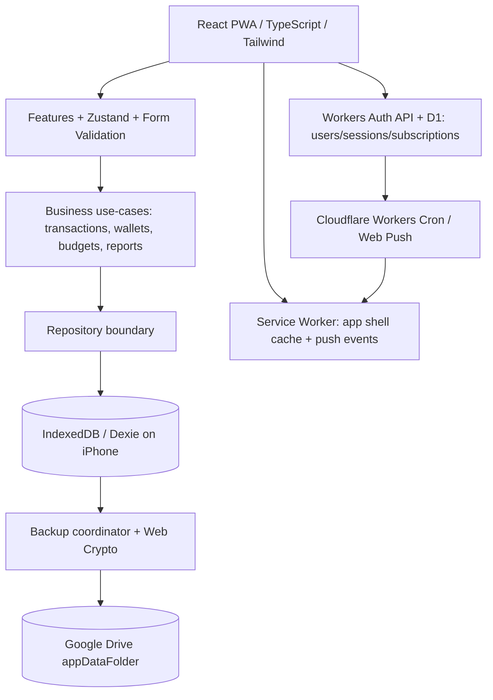
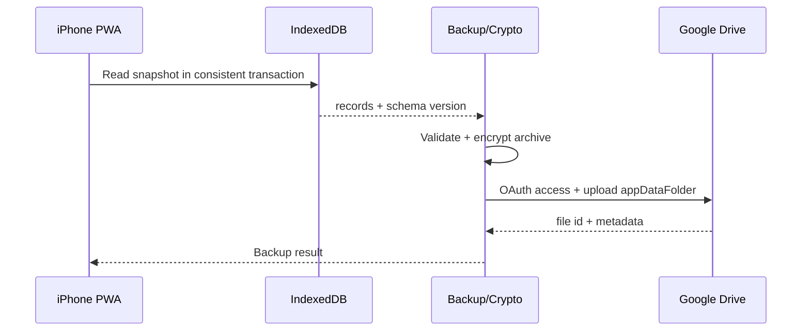
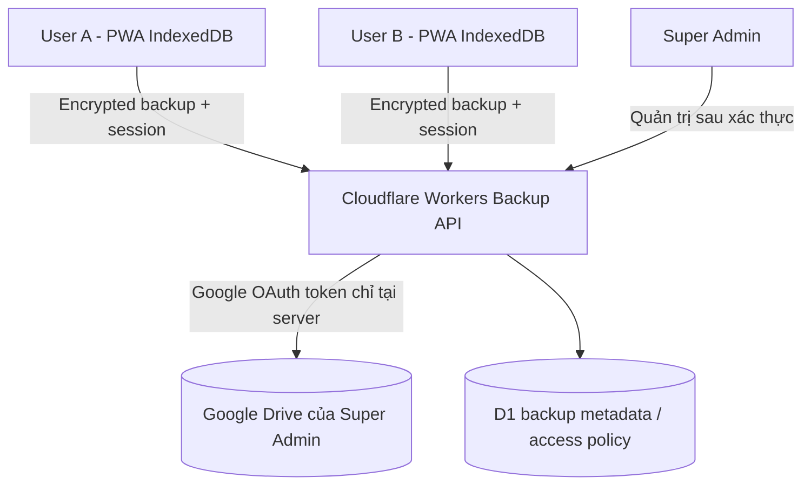
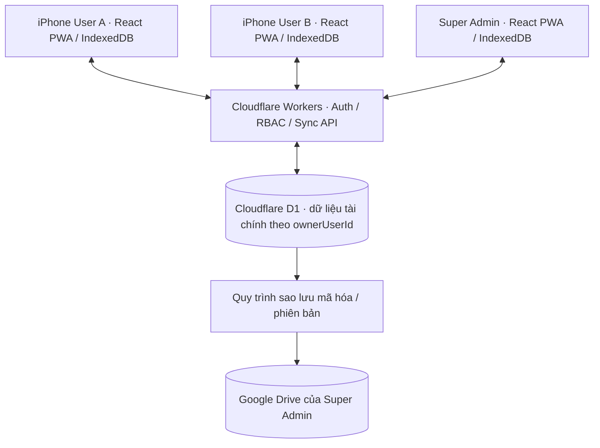

# SYSTEM DESIGN — Quản lý thu chi cá nhân (React PWA trên iPhone)

> Bản thiết kế chuyển đổi kiến trúc: 22/10/2026. Trạng thái: phương án triển khai được người dùng chấp thuận; các quyết định ranh giới web được nêu ở mục 12 vẫn mở. Nguồn: Requirements và Project Specification cùng tên.

## 1. Mục đích, phạm vi, nguyên tắc

- 2–3 người dùng với tài khoản độc lập và dữ liệu cá nhân tách biệt; phát triển hoàn toàn trên Windows; triển khai qua HTTPS và cài PWA từ Safari lên iPhone iOS 26+, **không App Store, không phí Apple Developer theo mục tiêu**.
- Giữ 21 FR, quy tắc 80%/100%, 21:00, hóa đơn T-1/T, tiết kiệm 25/50/75/100%, undo 10 giây, VND số nguyên, cho số dư âm.
- Giữ Google Drive `appDataFolder` chứa **archive có phiên bản, được mã hóa, có khóa khôi phục riêng**; offline trước; backup không phải đồng bộ realtime.
- **Bắt buộc username/password cho 2–3 tài khoản**; Apple ID là lựa chọn đăng nhập bổ sung theo PWA-01, phụ thuộc điều kiện Apple Developer. WebAuthn/passkey đã được xác nhận theo PWA-02; không gọi API Face ID native.
- Gói dịch vụ free tier là **mục tiêu ngân sách**, không phải đảm bảo hạn mức/độ sẵn sàng hoặc không có chi phí phát sinh.

## 2. Kiến trúc tổng thể



- **Presentation:** React + TypeScript + Vite; giao diện Tailwind/shadcn/ui/lucide-react là đề xuất, thiết kế tối giản theo ngôn ngữ iOS.
- **Domain:** hàm/UseCase độc lập framework cho ghi thu chi, chuyển tiền, tính budget, định kỳ, tiết kiệm, báo cáo; các tác vụ cập nhật liên quan phải bảo toàn tính nhất quán.
- **Persistence:** IndexedDB qua Dexie.js; tạo index cho `walletId`, `categoryId`, `occurredAt`, `type` và filter. Các phép ghi nhiều thực thể phải gói trong transaction IndexedDB.
- **PWA:** manifest `display: standalone`, icon, HTTPS, Workbox precache app shell, quy tắc cache asset; không cache response OAuth/token hay bản sao lưu giải mã.
- **Cloud:** ứng dụng tĩnh host trên Cloudflare Pages Free (đề xuất); Workers + D1 đề xuất để xác thực 2–3 tài khoản, phiên đăng nhập và đăng ký Web Push. Google Drive chỉ chứa backup; không thay thế local DB.
- **Scheduled notification (PWA-03 đã xác nhận):** Cloudflare Workers Cron + Web Push/VAPID + kho subscription phân vùng theo tài khoản, trong hạn mức miễn phí. Không bảo đảm giao đúng từng phút; thông tin tài chính không gửi trực tiếp đến push server khi chưa có chính sách phù hợp.

## 3. Cấu trúc mã nguồn đề xuất

```text
src/
  app/                 # Router, providers, bootstrap
  features/
    dashboard/ transactions/ wallets/ categories/ budgets/
    recurring/ savings/ reports/ search/ receipts/ settings/
  domain/              # entities, values, calculation policies, use-cases
  infrastructure/
    db/                # Dexie schema, migrations, repositories
    backup/            # serialize, validate, encrypt, Google Drive adapter
    oauth/             # Google sign-in and token lifecycle
    notifications/     # web push subscription, schedules, dedupe
    auth/              # Apple ID web feasibility, lock/passkey adapter
  components/          # shared UI
  workers/             # service worker, app cache, push listeners
  tests/               # unit, integration, browser tests
```

## 4. Mô hình dữ liệu IndexedDB (thiết kế đề xuất)

```mermaid
erDiagram
  WALLET ||--o{ TRANSACTION : contains
  CATEGORY ||--o{ TRANSACTION : classifies
  WALLET ||--o{ TRANSFER : sends_or_receives
  BUDGET ||--o{ BUDGET_ALERT : emits
  SAVINGS_GOAL ||--o{ SAVINGS_CONTRIBUTION : has
  RECURRING_RULE ||--o{ RECURRING_OCCURRENCE : generates
  TRANSACTION { string id PK; string type; int amountVnd; string walletId; string categoryId; datetime occurredAt; string note; string tags; boolean deleted }
  WALLET { string id PK; string name; int openingBalanceVnd; boolean archived }
  CATEGORY { string id PK; string name; string type; boolean archived }
  TRANSFER { string id PK; string sourceWalletId; string targetWalletId; int amountVnd; datetime occurredAt }
  BUDGET { string id PK; string categoryId; int limitVnd; string month }
  BUDGET_ALERT { string id PK; string budgetId; string period; int threshold }
  SAVINGS_GOAL { string id PK; int targetVnd; datetime deadline }
  SAVINGS_CONTRIBUTION { string id PK; string goalId; int amountVnd; datetime occurredAt }
  RECURRING_RULE { string id PK; string cadence; int amountVnd; datetime dueAt }
  RECURRING_OCCURRENCE { string id PK; string ruleId; string status; datetime dueAt }
```

- **Các bảng/đối tượng:** `wallets`, `categories`, `transactions`, `transfers`, `budgets`, `budgetAlerts`, `savingsGoals`, `savingsContributions`, `recurringRules`, `recurringOccurrences`, `notificationState`, `backupMetadata`, `appSettings`.
- UUID cho ID; thời điểm chuẩn hóa lưu UTC, hiển thị/tính kỳ theo múi giờ thiết bị (TD-08), chú ý chuyển múi giờ và DST.
- Tiền VND bằng số nguyên; kiểm soát `Number.isSafeInteger` và miền giá trị đầu vào. Nếu cần số vượt safe integer phải chuyển sang biểu diễn decimal-string/BigInt có codec tương thích archive; **chưa có yêu cầu giá trị cực đại**.
- Số dư = opening balance + thu – chi + chuyển vào – chuyển ra. **Không** tính chuyển khoản là thu/chi; số dư âm cho phép (TD-03).
- Ví/danh mục đã có giao dịch **không cho xóa vật lý**; giải pháp lưu trữ/ẩn (archive) là đề xuất thiết kế. Xóa giao dịch có undo 10 giây, bảo đảm rollback trạng thái.
- Một mốc budget 80%/100% chỉ tạo cảnh báo **một lần mỗi kỳ** (TD-09), lưu dedupe key trong `budgetAlerts`.
- Thiết kế indexes + schema migration Dexie có test nâng cấp dữ liệu và khôi phục bản cũ.

## 5. Quy tắc nghiệp vụ và invariant

| Vấn đề | Quy tắc đã xác nhận |
|---|---|
| Thu/chi | Ghi nhận các trường số tiền, danh mục, ngày giờ, ví, ghi chú, nhãn |
| Ví và chuyển tiền | opening balance, có thể âm; transfer không tính tổng thu/chi |
| Danh mục | Mặc định + thêm/sửa/xóa, ngăn xóa nếu đang được tham chiếu |
| Ngân sách | Theo tổng tháng và danh mục; ngưỡng 80% và đạt/vượt 100% |
| Định kỳ | Ngày/tuần/tháng; tới kỳ nhắc, chỉ ghi khi xác nhận |
| Tiết kiệm | Tiền chỉ được ghi khi chủ động thêm; milestone 25/50/75/100% và gần hạn/tuần |
| Xóa | Hoàn tác trong 10 giây |
| Báo cáo | Lịch/múi giờ thiết bị; PDF thời gian, tổng thu/chi, biểu đồ, giao dịch |

## 6. Luồng thao tác chính

### 6.1 Ghi giao dịch

1. Người dùng mở form, chọn thu/chi, số tiền, danh mục, ví, thời gian, ghi chú và nhãn.
2. Zod kiểm tra tính hợp lệ → UseCase tính thay đổi → Dexie transaction lưu dữ liệu.
3. UI cập nhật số dư, báo cáo, ngân sách; đánh dấu local data dirty để backup khi có điều kiện.
4. Nếu xóa, đặt trạng thái có thể hoàn tác 10 giây; khi hết thời gian xử lý chính thức theo chính sách lưu/xóa đã xác nhận ở tính năng.

### 6.2 Chuyển tiền

- Ghi `transfer` duy nhất và điều chỉnh phép tính số dư hai ví trong transaction; không tạo thu/chi giả. Kiểm tra các ví đang tồn tại và tham chiếu hợp lệ.

### 6.3 Ngân sách

- Tính theo giao dịch hợp lệ trong kỳ; so sánh ngân sách tổng và danh mục; ghi nhận mốc 80/100% theo khóa (`budgetId`, tháng, threshold) để không gửi trùng.

### 6.4 Khoản định kỳ

- Tạo occurrence từ rule ngày/tuần/tháng; trước hạn 1 ngày và đúng hạn cần nhắc; occurrence giữ trạng thái chờ cho tới khi người dùng xác nhận trả tiền mới ghi transaction.

### 6.5 Tiết kiệm

- Người dùng tạo mục tiêu và đóng góp thủ công; xác định tỷ lệ tiến độ; cảnh báo các mốc, gần hạn và tổng kết tuần. Lịch cụ thể gần hạn/tuần vẫn OQ-03.

### 6.6 Quét hóa đơn

- PWA mở camera qua API trình duyệt (HTTPS + quyền người dùng), chụp ảnh, OCR bằng Tesseract.js (đề xuất); parser chỉ gợi ý số tiền, ngày và nội dung; người dùng chỉnh và xác nhận trước khi ghi. Xử lý OCR lỗi còn OQ-04.

### 6.7 Báo cáo và PDF

- Repository lọc theo thời gian, danh mục, ví, số tiền, nhãn, từ khóa; Recharts vẽ biểu đồ. Export PDF chứa kỳ, tổng thu/chi, biểu đồ và danh sách giao dịch, cần kiểm thử font Unicode tiếng Việt và hiệu năng Safari.

## 7. Google Drive Backup — thiết kế dữ liệu và bảo mật



- Dữ liệu lưu local trong IndexedDB; backup snapshot được serialize theo schema version, kiểm tra tính toàn vẹn, mã hóa bằng Web Crypto trước khi tải lên Drive `appDataFolder` với scope tối thiểu `drive.appdata`.
- Đã chốt archive phiên bản, mã hóa, **khóa khôi phục riêng** và xác nhận trước khi thay dữ liệu (TD-06/07). Cách tạo và lưu recovery key, thuật toán KDF/parameters là thiết kế chưa chốt.
- Khôi phục: chọn bản backup → tải file → xác thực/giải mã/kiểm tra version → xem cảnh báo ảnh hưởng → **xác nhận trước khi thay dữ liệu** → nhập trong transaction có phương án rollback/recovery.
- Khi offline hoặc OAuth hết hiệu lực: giữ dữ liệu local, hiển thị trạng thái backup chưa hoàn tất, retry khi có điều kiện (không cam kết browser tự chạy nền).
- **Chưa chốt OQ-05:** lịch/kích hoạt backup, số phiên bản giữ, cách khôi phục chi tiết. Không mặc định upload từng thao tác hay sync realtime.
- Google OAuth web nên dùng authorization-code PKCE, kiểm chứng yêu cầu origin, token/session, hạn mức và chính sách OAuth app. Không để client secret trong frontend; không đưa access token vào archive hoặc log.

## 8. Thông báo PWA lúc 21:00 và giới hạn iOS

- PWA iPhone có Web Push nếu đã cài vào Home Screen, cấp quyền thông báo trong ngữ cảnh hợp lệ; service worker xử lý `push` khi nhận tin. **Không có cách tin cậy để tự chạy JS chính xác 21:00 khi app bị đóng**.
- **Giữ TD-05:** nếu app không hoạt động, nội dung push nhắc **mở app xem số liệu mới nhất**, không khẳng định server có số thu chi hôm nay.
- Để gửi khi đóng app cần endpoint đăng ký subscription + lưu subscription + dịch vụ Cron/Push + VAPID; gợi ý Cloudflare Workers/D1 hoặc KV, **chưa chốt** vì đưa thêm thành phần backend/serverless và có vấn đề quyền riêng tư.
- **Quy tắc điều kiện 'chưa có giao dịch hôm nay':** server push không tự biết dữ liệu thu chi chỉ nằm trong IndexedDB. Lựa chọn phải phê duyệt: gửi lời nhắc tổng quát, hoặc lưu metadata tối thiểu ngày ghi giao dịch trên server có sự đồng ý, hoặc chỉ kiểm tra điều kiện khi app mở.
- Ngân sách/tiết kiệm/định kỳ: tính trong app khi dữ liệu mới; muốn thông báo khi đóng app phải có cơ chế gửi lịch/metadata an toàn, chưa thiết kế xong. Dedup theo TD-09 và kiểm tra lại khi online.
- Không bảo đảm push đến chính xác 21:00 vì mạng, Focus, permission, hạ tầng và chính sách hệ điều hành.

## 9. Xác thực và quyền riêng tư

- **Sign in with Apple** cho web khác Sign in with Apple native: cần kiểm tra domain, Service ID/khả năng cấu hình và điều kiện Developer; không tuyên bố làm hoàn toàn miễn phí nếu điều kiện Apple không đáp ứng.
- **Face ID/mật mã:** website không được gọi LocalAuthentication; WebAuthn/passkey với user verification có thể dùng cơ chế sinh trắc học/mật mã của hệ điều hành nhưng không bảo đảm mọi thiết bị/mọi trường hợp có Face ID. Cần chốt cách khóa app/khôi phục.
- Google OAuth là quyền riêng phục vụ Drive, không tự thay thế Apple ID login. Bảo vệ access token trong phiên; không hard-code credential/secret, không log dữ liệu thu chi, không gửi dữ liệu tài chính lên push server nếu không được phép.
- Dữ liệu IndexedDB có thể mất khi người dùng xóa website data/ứng dụng, dùng chế độ riêng tư hoặc do chính sách lưu trữ: xem Google Drive backup là tuyến khôi phục chủ đạo.

## 10. Kiểm thử và nghiệm thu

| Nhóm | Kiểm thử cần thực hiện |
|---|---|
| Giao dịch | VND số nguyên, thu/chi, sửa/xóa, undo 10 giây, chống nhập trùng |
| Ví | Số dư âm, opening balance, chuyển tiền hai ví không thay đổi tổng thu/chi |
| Danh mục | Không xóa dữ liệu đang được tham chiếu |
| Ngân sách | Mốc 80/100%, dedup theo kỳ và theo danh mục |
| Offline | Đóng/mở PWA không Internet, cập nhật DB, reload service worker, nâng cấp schema |
| Drive | Google OAuth, access revoke, hết dung lượng, file lỗi, key sai, rollback restore |
| iPhone | Add to Home Screen, camera, font PDF tiếng Việt, IndexedDB, Safari iOS 26 |
| Push | quyền denied, app đóng, timezone, Focus, đăng ký/hủy subscription, cron trễ |
| Bảo mật | Apple ID web feasibility, passkey browser support, lỗi/mất recovery key |

Chưa chốt tiêu chí tốc độ nhập liệu định lượng (OQ-01).

## 11. Phân kỳ ưu tiên

- **Cốt lõi:** thu chi, ví, danh mục, ngân sách, dashboard, thông báo; nền tảng offline/backup, bảo mật và auth cần xử lý trước nghiệm thu.
- **Cao:** báo cáo, định kỳ, tiết kiệm, tìm kiếm.
- **Trung bình:** OCR hóa đơn, PDF.
- Không tự thêm lịch deadline; mục tiêu triển khai tự làm, free-tier phù hợp hạn mức.

## 12. Các quyết định đã chốt và các câu hỏi mở

### 12.1 Năm câu hỏi nghiệp vụ vẫn mở

- **OQ-01:** Tiêu chí nhập thu chi nhanh có thể đo được là gì?
- **OQ-02:** Có cần import lịch sử từ Sổ Thu Chi MISA?
- **OQ-03:** “Gần hạn” mục tiêu tiết kiệm tính trước bao nhiêu ngày, báo cáo tuần vào ngày/giờ nào?
- **OQ-04:** OCR thất bại hoặc gợi ý sai xử lý cụ thể thế nào?
- **OQ-05:** Lịch backup, số phiên bản, quy trình restore chi tiết?

### 12.2 Chín quyết định TD-01 đến TD-09 đã xác nhận (giữ nội dung nghiệp vụ)

| Mã | Nội dung đã xác nhận | Áp dụng trên PWA |
|---|---|---|
| TD-01 | iOS 26 trở lên | iPhone Safari PWA trên iOS 26+; không còn phụ thuộc Xcode |
| TD-02 | VND, lưu số nguyên | JS safe integer + validation |
| TD-03 | Số dư ban đầu, cho phép âm; không xóa ví/danh mục có giao dịch | IndexedDB transaction + validation |
| TD-04 | Tiết kiệm thêm thủ công; định kỳ ngày/tuần/tháng | Business use cases |
| TD-05 | 21:00 khi app không hoạt động: nhắc mở app xem số liệu chính xác | Web Push + dịch vụ hẹn lịch cần chốt; không cam kết gửi từ PWA đóng |
| TD-06 | Archive có phiên bản trong `Google Drive appDataFolder` | OAuth + Drive REST API |
| TD-07 | Archive mã hóa, recovery key riêng, xác nhận trước thay dữ liệu | Web Crypto + restore confirmation |
| TD-08 | Theo lịch/múi giờ máy; PDF có khoảng thời gian, tổng thu/chi, biểu đồ và giao dịch | Browser date/report PDF library |
| TD-09 | Mỗi mốc cảnh báo một lần/kỳ, kiểm tra lại khi có mạng | Dedupe key local + push state (nếu có) |

### 12.3 Quyết định PWA đã chốt và chi tiết triển khai còn mở

- **PWA-01:** Giữ Apple ID như phương thức bổ sung, nhưng ưu tiên **username/password bắt buộc**. Apple ID web còn điều kiện cấu hình/chi phí Apple Developer, chưa đảm bảo ra mắt miễn phí.
- **PWA-02:** WebAuthn/passkey dùng xác thực thiết bị, còn mở quy trình đăng ký/thay thế thiết bị/khôi phục.
- **PWA-03:** Web Push + Cloudflare Workers Cron trong free tier đã chốt; còn mở thiết kế subscription, giờ địa phương, giới hạn PWA offline và cách đánh giá trạng thái “chưa ghi giao dịch”.
- **PWA-04:** IndexedDB + Google Drive archive mã hóa, có phiên bản và khôi phục đã chốt; còn mở OQ-05 về lịch và cơ chế khôi phục cụ thể.

## 13. Ma trận truy vết

| Yêu cầu | Thành phần |
|---|---|
| FR-01–04 | Transactions, Categories, Dexie transactions/undo |
| FR-05–06 | Wallets, Transfers, balance use-case |
| FR-07–08 | Budgets, budgetAlerts, conditional notifications |
| FR-09, FR-14–15 | Dashboard, Reports, Recharts |
| FR-10–13 | Notifications, push/subscription/cron (phần chưa chốt) |
| FR-16–17 | Savings, recurring rules, occurrence confirmation |
| FR-18 | IndexedDB indexes + SearchFilter |
| FR-19–20 | Camera browser + OCR adapter |
| FR-21 | PDF export adapter |
| NFR-01–02 | React PWA, iOS 26+ installed Home Screen |
| NFR-03–04 | Apple ID web feasibility, WebAuthn/passkey feasibility |
| NFR-05–06 | IndexedDB offline + Drive encrypted backup |

## 14. Tham khảo

- Apple Web Push for Web Apps: https://developer.apple.com/documentation/usernotifications/sending-web-push-notifications-in-web-apps-and-browsers
- WebKit iOS PWA Web Push: https://webkit.org/blog/13878/
- Google Drive appDataFolder: https://developers.google.com/workspace/drive/api/guides/appdata
- Cloudflare Cron triggers: https://developers.cloudflare.com/workers/configuration/cron-triggers/
- Apple Add website to Home Screen: https://support.apple.com/guide/iphone/turn-a-website-into-an-app-iph4f6a5d39d/ios

**Trạng thái:** Đã chuyển thiết kế sang React PWA cho Windows theo quyết định mới. Chưa bắt đầu code; OQ-01 đến OQ-05 và PWA-AUTH/LOCK/PUSH/DATA cần xác nhận để tài liệu đủ tiêu chuẩn triển khai.

## 15. Bổ sung thiết kế đa tài khoản và xác thực (đã được người dùng xác nhận 22/10/2026)

**Ràng buộc cốt lõi (cập nhật):** 2–3 người dùng đăng nhập username/password; User chỉ quản lý dữ liệu mình, Super Admin có quyền quản trị và thao tác dữ liệu mọi tài khoản. Apple ID vẫn là tùy chọn bổ sung mong muốn từ PWA-01 nhưng không thể mặc định miễn phí. PWA-02 WebAuthn/passkey, PWA-03 Workers Cron/Web Push, PWA-04 IndexedDB + Google Drive encrypted versioned backup đã được chốt.

### 15.1 Luồng xác thực (đề xuất kỹ thuật, chưa chốt UX)

1. Client HTTPS nhập username/password -> Workers Auth API.
2. Server truy xuất `users` trong D1, xác minh **password hash có salt** bằng thư viện/thuật toán thích hợp cho Workers (không dùng SHA-256 đơn thuần); giới hạn brute-force, phản hồi lỗi không lộ tài khoản tồn tại.
3. Sau khi hợp lệ, phát hành session bảo vệ bằng cookie `HttpOnly; Secure; SameSite` và có expiry/revocation phù hợp; không đặt password hoặc refresh token nhạy cảm trong localStorage.
4. Gắn `userId` của phiên vào tất cả API đăng ký push, tài nguyên và các thao tác restore/backup metadata; server không tin `userId` client tự khai.
5. IndexedDB có namespace/database riêng theo `userId`; khi logout hoặc đổi account phải khóa/loại bỏ session và ngăn truy cập dữ liệu account trước, kể cả trên cùng iPhone. Có IndexedDB riêng **chưa phải mã hóa**, cần cơ chế mở khóa/phân tách khóa cục bộ để chống truy cập chéo khi thiết bị dùng chung.
6. Khi offline, không có server để xác thực username/password mới: luồng unlock offline bằng passkey và cache session đã xác thực cần **quyết định và kiểm thử riêng**, không hứa tự động đăng nhập offline cho bất kỳ username nào.

### 15.2 Phân vùng lưu trữ và sao lưu

- Giao dịch, ví, ngân sách, tiết kiệm, danh mục, biểu đồ và PDF chỉ đọc dữ liệu theo người dùng đã xác thực.
- Sao lưu lên Google Drive `appDataFolder` theo danh tính Google đã được từng người cấp OAuth và metadata `ownerUserId`; mã hóa với khóa khôi phục riêng cho từng người. **Chưa chốt** liệu mỗi người có Google Drive riêng hay cùng một Drive với phân vùng và khóa độc lập.
- Không lưu dữ liệu thu chi của mọi người vào D1 theo mặc định; D1 giữ tài khoản, phiên, đăng ký push và metadata cần thiết. Không coi Cloudflare D1 là kho dữ liệu tài chính chính.
- Dịch vụ Push có đăng ký và trạng thái gửi riêng theo userId, tránh gửi nhầm hoặc hiển thị chi tiết tài chính không được phép trên màn hình khóa.

### 15.3 Kiểm thử bắt buộc

- Tài khoản A đăng nhập, tạo giao dịch; B đăng nhập trên cùng iPhone không thể thấy dữ liệu, file cache, export, bản sao lưu hoặc token của A.
- Thử thay đổi userId trong request và liên kết backup; backend phải từ chối khi khác chủ sở hữu.
- Đăng xuất, session hết hạn, gỡ passkey, sai mật khẩu, đổi thiết bị, offline kéo dài và khôi phục Drive phải có test riêng.
- Push 21:00 mỗi account đúng đăng ký và không rò dữ liệu account khác.

### 15.4 Câu hỏi còn mở sau thay đổi

1. **Đã chốt:** chỉ Admin tạo tài khoản mới; không tự đăng ký công khai.
2. Quên mật khẩu hoặc thay đổi thiết bị phục hồi tài khoản bằng gì?
3. Quy tắc mở khóa offline sau lần đăng nhập online đầu tiên?
4. Mỗi người kết nối Drive riêng hay một Drive dùng chung nhưng backup tách biệt?
5. Có yêu cầu Apple ID hoạt động ngay bản đầu hay cho phép bổ sung khi đủ điều kiện Apple Developer?

**Ghi chú khả thi/chi phí:** Mục tiêu 0 đồng chỉ đạt khi hạ tầng nằm trong hạn mức miễn phí; điều kiện Sign in with Apple web phải kiểm chứng độc lập, không cam kết có thể phát hành Apple OAuth mà không cần tham gia Apple Developer Program.

## 16. Thiết kế RBAC Admin/User — quyết định đã xác nhận (22/10/2026) <!-- RBAC-ADMIN-2026-10-22 -->

### 16.1 Ranh giới quyền

| Hành động | Admin | User |
|---|---|---|
| Tạo tài khoản User | Cho phép | Từ chối |
| Tự đăng ký công khai | Không | Không |
| Quản lý dữ liệu tài chính của chính mình | Cho phép | Cho phép |
| Xem/thêm/sửa/xóa dữ liệu tài chính của người khác | Cho phép với Super Admin | Từ chối |
| Sao lưu/khôi phục Google Drive của người khác | Cho phép khi có quyền Drive và khóa giải mã | Từ chối |

**Quy tắc mới nhất:** Super Admin có toàn quyền tài chính và quản trị đối với mọi tài khoản; User chỉ thao tác dữ liệu thuộc mình. Truy cập backup mã hóa vẫn đòi hỏi quyền Google Drive và khóa giải mã hợp lệ.

### 16.2 Kiến trúc kiểm soát quyền (đề xuất triển khai)

- **D1 `users`:** bổ sung `role` (`SUPER_ADMIN`/`USER`); username duy nhất; password hash phù hợp cho xác thực phía server. Vai trò đọc từ phiên xác thực và bản ghi server, không lấy từ form/client.
- **API nội bộ:** `POST /api/admin/users` chỉ cho `SUPER_ADMIN`; xác minh session server, kiểm tra quyền, validate dữ liệu và từ chối các vai trò do client tự nâng quyền. Không có endpoint `POST /register` công khai.
- **Client React:** chỉ hiển thị mục **Quản trị tài khoản → Tạo người dùng** cho Admin; ẩn mục này với User. Ẩn UI chỉ để cải thiện UX, **không thay thế** authorization phía server.
- **Tạo tài khoản:** Admin gửi thông tin hợp lệ → Workers kiểm tra quyền → tạo tài khoản User trong D1 → trả kết quả không chứa password hash. Cách cấp mật khẩu ban đầu và giao thông tin đăng nhập còn mở.
- **Mỗi API dữ liệu theo tài khoản:** xác minh session và role phía server; User bắt buộc trùng `ownerUserId`, Super Admin được quyền chỉ định `targetUserId` cho mọi tài khoản; ghi audit khi truy cập/thay đổi xuyên tài khoản. IndexedDB và Drive archive vẫn tách riêng theo owner; cơ chế trao đổi dữ liệu/khóa của Super Admin chưa chốt.

### 16.3 Kiểm thử quyền bắt buộc

1. Admin tạo User thành công; User mới đăng nhập được sau khi hoàn thành bước cấp thông tin đăng nhập.
2. User gọi trực tiếp `POST /api/admin/users` → 403, không tạo bản ghi.
3. Khách chưa đăng nhập gọi API tạo người dùng → 401.
4. Super Admin chọn User khác → có quyền thao tác sau khi dữ liệu được cung cấp và giải mã hợp lệ; User giả mạo `targetUserId` → bị từ chối.
5. Client sửa trường `role=SUPER_ADMIN` → server từ chối quyền tạo Admin khác khi chưa có yêu cầu xác nhận.
6. Đăng xuất/đổi tài khoản không làm lộ dữ liệu/khóa của người trước.

### 16.4 Chưa quyết định

Bootstrap Super Admin đầu tiên, cấp/khôi phục mật khẩu và khóa giải mã, thu hồi phiên và cơ chế tiếp cận dữ liệu các thiết bị: cần thiết kế cụ thể. Quyền Super Admin toàn hệ thống đã xác nhận; việc cấp quyền không được vô hiệu hóa bảo mật. Các OQ-01 đến OQ-05 và các điểm kỹ thuật PWA còn mở khác vẫn giữ nguyên.


## 17. Thiết kế Super Admin toàn quyền (quyết định đã xác nhận 22/10/2026) <!-- SUPERADMIN-2026-10-22 -->

### 17.1 Quyết định và ma trận quyền

Quyết định này **thay thế** mọi đoạn trước đây nêu Admin không thể xem/sửa dữ liệu tài khoản khác.

| Thao tác | Super Admin | User |
|---|---|---|
| Tạo/quản trị tài khoản, quản lý cấu hình | Cho phép | Từ chối |
| Xem/thêm/sửa/xóa dữ liệu tài chính của bản thân | Cho phép | Cho phép |
| Xem/thêm/sửa/xóa/xuất dữ liệu tài chính tài khoản khác | Cho phép | Từ chối |
| Tạo báo cáo và kiểm tra ngân sách cho tài khoản khác | Cho phép | Từ chối |
| Truy cập backup người khác | Cho phép khi có quyền Drive + khóa giải mã hợp lệ | Từ chối |

### 17.2 Kiến trúc kiểm soát truy cập (đề xuất triển khai)

- D1 `users.role`: `SUPER_ADMIN` hoặc `USER`. Backend lấy role từ session server, không từ payload do client cung cấp.
- Các API quản trị người dùng, tài nguyên tài chính và backup metadata xác minh `actorUserId`, `targetUserId`, action; cho phép nếu `actor.role == SUPER_ADMIN` hoặc `targetUserId == actorUserId` đối với hành động tự quản lý thuộc phạm vi User.
- Admin UI có **bộ chọn tài khoản đích**; mọi màn hình thu chi / báo cáo / xuất PDF thể hiện tài khoản sở hữu rõ ràng. Tránh thao tác nhầm tài khoản bằng xác nhận thích hợp với thao tác xóa hàng loạt và khôi phục.
- Audit log server lưu actor, target, action, timestamp và kết quả; không log mật khẩu, recovery key, nội dung chi tiêu nhạy cảm.
- User A không được tự sửa `targetUserId` để truy cập User B; test trực tiếp API phải trả 403; giấu nút UI không phải biện pháp an ninh.

### 17.3 Ràng buộc offline và mã hóa cần giải quyết

**Chưa thể đảm bảo quyền xem/sửa dữ liệu tài khoản khác vận hành đầy đủ với kiến trúc hiện tại:** giao dịch chỉ nằm trên IndexedDB của từng thiết bị và các bản sao Drive mã hóa. Super Admin không tự truy cập IndexedDB trên máy User; không thể giải mã backup bằng vai trò RBAC nếu không có khóa. Giữ nguyên Google Drive làm nơi backup chính; không tự tuyên bố đã chuyển sang cơ sở dữ liệu cloud dùng chung.

Cần chốt riêng: (1) đồng bộ dữ liệu giữa người dùng và Admin hay chỉ truy cập snapshot đã backup; (2) người dùng lưu Drive riêng hay vùng lưu chung có quyền đọc cho Admin; (3) chia sẻ khóa giải mã an toàn, ví dụ mã hóa khóa dữ liệu cho public key Admin, không đưa plaintext key lên server; (4) nếu Admin sửa dữ liệu account khác, cơ chế phát thay đổi về thiết bị User và xử lý xung đột; (5) audit và quy trình khôi phục khi mất khóa.

### 17.4 Test bắt buộc

1. Super Admin đăng nhập → chọn tài khoản User → chỉ được hiện dữ liệu thực sự có thể truy xuất/giải mã; nếu chưa đồng bộ, hiển thị trạng thái thiếu dữ liệu, không tự suy diễn.
2. Super Admin được thêm/sửa/xóa giao dịch của User khi nguồn dữ liệu dùng chung được thiết lập; thay đổi gắn đúng `ownerUserId` và lưu audit.
3. User A gọi API với `targetUserId=B` → 403; User A không thể cấp quyền cho mình.
4. Backup của User B thiếu khóa giải mã cho Admin → từ chối mở nội dung, không bypass encryption.
5. Đăng xuất, đổi account, thiết bị offline → không lộ cache, phiên hoặc khóa của tài khoản trước.


## Quyết định mới nhất — Google Drive tập trung của Super Admin (22/10/2026)

> **Đã được người dùng xác nhận.** Phần này ghi đè mọi đoạn cũ nói mỗi người sử dụng Google Drive riêng hoặc mỗi User phải tự cấp quyền OAuth Google Drive để sao lưu.

- Tất cả người dùng (dự kiến 2–3 tài khoản) có dữ liệu tài chính riêng trong IndexedDB trên iPhone của mình để hoạt động offline.
- **Tất cả bản sao lưu của mọi tài khoản phải được lưu vào duy nhất Google Drive do Super Admin sở hữu**; không yêu cầu User có hoặc kết nối tài khoản Google Drive riêng.
- Bản sao lưu được mã hóa và có phiên bản; tách biệt rõ theo `ownerUserId` và ID bản sao lưu; User chỉ được sao lưu và khôi phục dữ liệu của bản thân. Super Admin có quyền quản trị sao lưu và dữ liệu mọi tài khoản sau khi xác thực/ủy quyền phù hợp.
- Google Drive là **đích sao lưu**, không mặc nhiên là cơ sở dữ liệu giao dịch realtime. Dữ liệu trên iPhone User chưa tải lên sẽ không xuất hiện trong bản sao lưu Super Admin có thể đọc.
- Không nhúng Google OAuth access token/refresh token hoặc khóa bí mật của Super Admin vào mã React PWA, IndexedDB của User, hay trả chúng về trình duyệt. Mọi truy cập Google Drive chung phải qua API server được kiểm tra session, `ownerUserId` và role.
- Vẫn phải thiết kế cách quản lý khóa mã hóa để Super Admin có thể giải mã hợp lệ bản sao lưu của User mà không lưu khóa khôi phục dạng văn bản thuần trên server.

**Cần thiết kế/chốt tiếp, chưa tự xem là quyết định được phê duyệt:** (1) OAuth Google cấp quyền cho dịch vụ server truy cập Drive của Super Admin, lưu và xoay vòng refresh token an toàn; (2) chính sách cấp khóa giải mã cho Admin và khôi phục khi mất khóa; (3) chu kỳ tự sao lưu, số phiên bản và cơ chế retry; (4) Admin xem dữ liệu đã backup hay cần dữ liệu mới nhất, và nếu Admin sửa dữ liệu User thì đồng bộ ngược thế nào. Các OQ còn mở khác vẫn giữ nguyên.

### Phương án kỹ thuật triển khai đề xuất (chưa chốt chi tiết)



- **Đề xuất luồng backup:** PWA tạo snapshot nhất quán, mã hóa archive → gọi `POST /api/backups` bằng phiên tài khoản → Workers kiểm tra vai trò và gắn `ownerUserId` từ session → ghi archive vào `appDataFolder` của Google Drive Super Admin bằng OAuth mà Admin đã ủy quyền cho backend → lưu metadata (`backupId`, `ownerUserId`, `version`, `createdAt`, `checksum`, `driveFileId`, `status`) tại D1.
- **Đề xuất luồng restore:** User gọi `GET /api/backups` chỉ thấy archive của mình; Admin có thể chỉ định tài khoản đích. Backend kiểm tra RBAC trước khi cung cấp archive mã hóa; phía client xác thực checksum/chữ ký và giải mã bằng cơ chế khóa hợp lệ, yêu cầu xác nhận trước khi thay dữ liệu IndexedDB.
- **Ràng buộc Google:** `appDataFolder` thuộc Drive của tài khoản Google đã cấp OAuth, không phải Drive của người dùng ứng dụng chỉ vì họ đăng nhập username/password. Folder này ẩn khỏi giao diện Drive thông thường và chỉ ứng dụng đã được cấp quyền phù hợp mới truy cập được. Nếu cần các file nhìn thấy trong Drive, phải thiết kế lại vị trí lưu và scope.
- **Bảo mật:** Worker không nhận quyền Drive rộng hơn cần thiết; token được lưu dạng secret được bảo vệ, không lộ vào JavaScript client hoặc log; đặt giới hạn dung lượng upload, xác thực loại file, quota/ratelimit và lưu audit. Phương án lưu trữ/bảo vệ refresh token lâu dài cần thẩm định trước khi triển khai.
- **Điểm chưa giải quyết:** Backup tập trung không tự động giải quyết mục tiêu Super Admin chỉnh sửa trực tiếp dữ liệu offline mới nhất trên điện thoại của User. Cần xác nhận chế độ đồng bộ hai chiều hay quyền thao tác trên snapshot đã backup.

## Quyết định kiến trúc mới nhất — Đồng bộ IndexedDB ⇄ D1 <!-- SYNC-2026-10-22 -->

**Đã xác nhận (22/10/2026):** Dữ liệu tài chính được lưu offline riêng trên iPhone bằng IndexedDB và **đồng bộ hai chiều khi có Internet** qua dịch vụ dữ liệu trung tâm. Super Admin có quyền xem/thêm/sửa/xóa dữ liệu mới nhất **đã đồng bộ** của tất cả tài khoản; thay đổi của Admin đồng bộ ngược về iPhone người sở hữu. **Google Drive của Super Admin tiếp tục là đích sao lưu tập trung mã hóa, có phiên bản**, không phải cơ sở dữ liệu đồng bộ trực tiếp.

**Giới hạn:** Dữ liệu mới chỉ lưu ở iPhone đang offline không thể hiện ở Admin cho tới khi đồng bộ thành công; thay đổi Admin cũng chỉ đến iPhone User sau khi thiết bị kết nối lại.

### Sơ đồ thành phần (đề xuất hiện thực)



### Thay đổi thiết kế
- **Đã chốt về hành vi:** đồng bộ tài chính hai chiều với kho trung tâm; Admin thao tác được dữ liệu của mọi tài khoản sau khi User đã đồng bộ.
- **Đề xuất công nghệ:** mở rộng Cloudflare Workers + D1 (trước đây chỉ chứa auth/session) để lưu tài chính trung tâm; cần kiểm tra giới hạn và chi phí thực tế của Free tier trước triển khai.
- IndexedDB mỗi người có `outbox` chứa thao tác chờ gửi, `operationId` để retry idempotent, cursor hoặc revision để nhận thay đổi từ server.
- Server giữ `ownerUserId`, revision, trạng thái thay đổi; kiểm tra role từ session cho từng request. User chỉ được tài khoản mình, Super Admin được chọn `targetUserId`; audit mọi sửa/xóa xuyên tài khoản.
- Luồng `push`: User ghi IndexedDB/outbox → có mạng gửi Worker → kiểm tra quyền + áp dụng thay đổi đúng một lần vào D1 → trả revision.
- Luồng `pull`: ứng dụng hỏi các thay đổi từ revision/cursor mới nhất → cập nhật IndexedDB; thay đổi của Admin được User nhận trong lần pull tiếp theo.
- Với chuyển tiền giữa ví hoặc nghiệp vụ đa bản ghi, bảo đảm tính nhất quán/transaction, tránh đồng bộ một phần.
- **Xung đột chưa chốt:** Admin và User sửa cùng dữ liệu ở hai phiên bản khác nhau; thiết kế cần phát hiện và hiển thị xung đột, chưa mặc định 'last-write-wins' hoặc tự ghi đè. Quy tắc xóa mềm/hoàn tác 10 giây qua thiết bị cũng chưa chốt.
- **Google Drive không thay thế D1:** archive sao lưu mã hóa/versioned vẫn vào Drive Super Admin qua backend, giữ token Google bí mật ngoài client. Cách xuất snapshot khi thiết bị chưa đồng bộ, phân phối khóa giải mã và lịch/phiên bản backup chưa chốt.
- Trạng thái UI: offline/chờ đồng bộ/đã đồng bộ/lỗi; không cam kết dữ liệu offline xuất hiện tức thì cho Admin.

**Thứ tự ưu tiên:** Mục này ghi đè nội dung lịch sử nói D1 chỉ lưu accounts hoặc không đồng bộ tài chính; các quyết định khác giữ nguyên.
